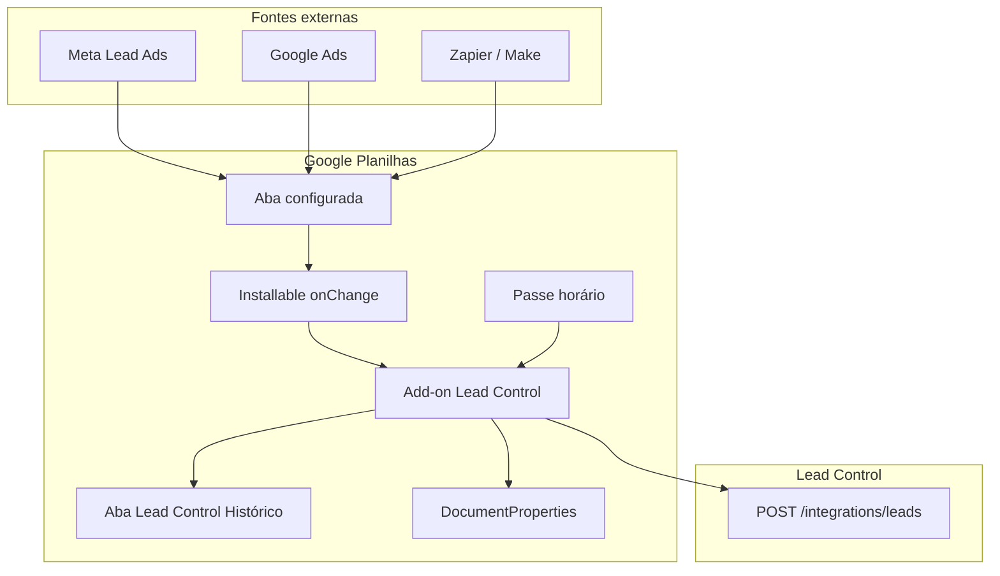

# Arquitetura

## Propósito

O add-on monitora uma aba configurada da planilha do cliente e, quando novas linhas são adicionadas (tipicamente por integrações automáticas de tráfego pago), mapeia os dados para o formato da API Lead Control e envia um POST para cada lead válido.

## Fluxo de dados



## Por que onChange e não onEdit?

Integrações externas escrevem na planilha via **Google Sheets API**. O trigger `onEdit` **não dispara** para alterações feitas por API — apenas para edições manuais do usuário.

O trigger installable `onChange` dispara para edições manuais e para alterações via API. Escritas pela Sheets API costumam chegar como `changeType = OTHER` (além de `EDIT` / `INSERT_ROW`).

Como `onChange` não informa qual linha mudou, o add-on mantém:

- `settledThrough` — última linha em que todas as anteriores já têm desfecho
- `openRows` — linhas acima disso ainda pendentes, em retry, ou fechadas fora de ordem

Um passe único (`processPendingRows`) é usado pelo `onChange` (após espera quieta), pelo trigger horário e pelo botão de recuperação.

## Estrutura de módulos

```
src/
├── main.ts                 # Entry point; exporta funções globais para o GAS
├── appsscript.json         # Manifest (scopes, add-on config)
├── types.ts                # Tipos e constantes compartilhados
├── config/settings.ts      # DocumentProperties (+ migração legada)
├── mapping/leadMapper.ts   # Mapeamento colunas → payload API
├── api/leadClient.ts       # UrlFetchApp POST / fetchAll
├── sync/                   # Funções puras + motor processPendingRows
├── logging/
│   ├── logger.ts
│   └── requestLog.ts
├── triggers/
│   ├── triggerManager.ts   # onChange + hourly
│   └── onChangeHandler.ts  # Espera quieta + handlers
└── ui/
    ├── homepage.ts
    └── notifications.ts
test/
└── sync.test.ts            # node:test (funções puras)
```

## Persistência de configuração

Cada planilha armazena a configuração em `PropertiesService.getDocumentProperties()` (sem fallback silencioso para UserProperties):

| Chave | Tipo | Descrição |
|-------|------|-----------|
| `apiEndpoint` | string | URL do endpoint POST |
| `apiKey` | string | Chave `x-api-key` |
| `companyId` | string | ID da empresa no Lead Control |
| `sheetName` | string | Aba monitorada |
| `enabled` | boolean | Integração ativa/inativa |
| `settledThrough` | number | Cursor de desfecho consecutivo |
| `openRows` | JSON | Mapa de linhas abertas / fechadas fora de ordem |
| `lastProcessedRow` | number | Espelho legado de `settledThrough` (compat UI) |
| `columnMappings` | JSON | Mapeamento de colunas |

Na primeira leitura, se DocumentProperties estiver vazio e existir config antiga em UserProperties, ela é copiada uma vez para o documento.

## Histórico de envios

A aba reservada `Lead Control - Histórico` é criada automaticamente. Cada POST (ou linha ignorada) gera uma linha com data, origem, resultado HTTP e mensagem (`error.code` + `error.message` quando a API devolve o envelope novo). Limite: últimas 1000 linhas.

## Build e deploy

TypeScript em `src/` é compilado com esbuild para `dist/Code.js`. Testes: `npm test` (incluído em `npm run verify`). O clasp envia apenas `dist/`.

## Proteções

- **Espera quieta** (~8s, teto ~20s, token no CacheService): vários writes da mesma linha viram um único passe
- **`OTHER` aceito**: escritas via Sheets API não são descartadas
- **Cursor `settledThrough` / `openRows`**: linha incompleta não queima o cursor; 400 fecha só aquela linha; 401/403 para o lote; 5xx/rede ficam em retry
- **Grace de 3 min** para campos obrigatórios vazios antes de Ignorado
- **Passe horário** (`onHourlySweep`): rede de segurança (mínimo 1h no add-on)
- **`UrlFetchApp.fetchAll`**: lotes de até 20 POSTs
- **LockService**: serializa o processamento
- **DocumentProperties obrigatório**: evita painel ativo com gatilho lendo config vazia
- **Reautorização**: grava aviso no histórico (no máx. 1/h) e para o sync até Extensões → Lead Control

## Funções globais expostas

| Função | Invocada por |
|--------|-------------|
| `onSheetsHomepage` | Manifest `homepageTrigger` |
| `onChangeHandler` | Trigger installable onChange |
| `onHourlySweep` | Trigger horário |
| `onInstall` | Instalação do add-on |
| `handleSaveConfiguration` | Botão "Salvar e ativar" |
| `handleDisableIntegration` | Botão "Desativar integração" |
| `handleTestLastRow` | Botão "Testar envio" |
| `handleReprocessLastRow` | Botão "Reprocessar última linha" |
| `handleReprocessUnsent` | Botão "Reprocessar não enviados (50)" |
| `handleOpenHistory` | Botão "Abrir histórico" |
